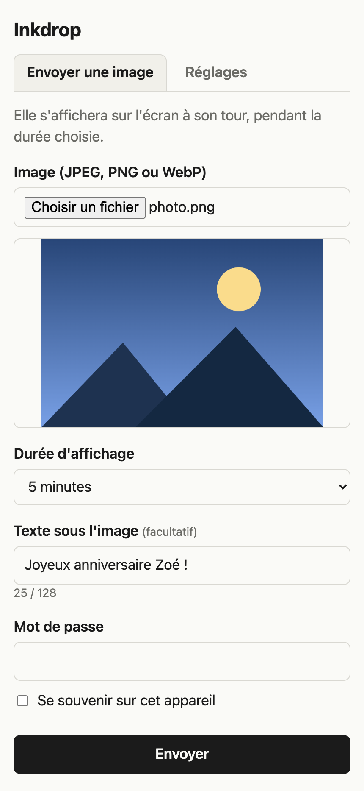
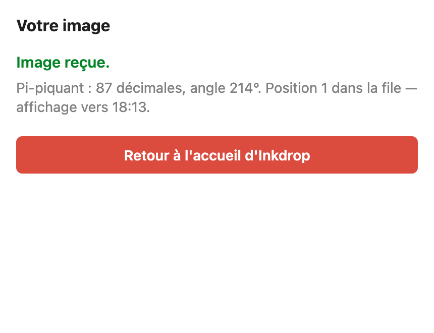
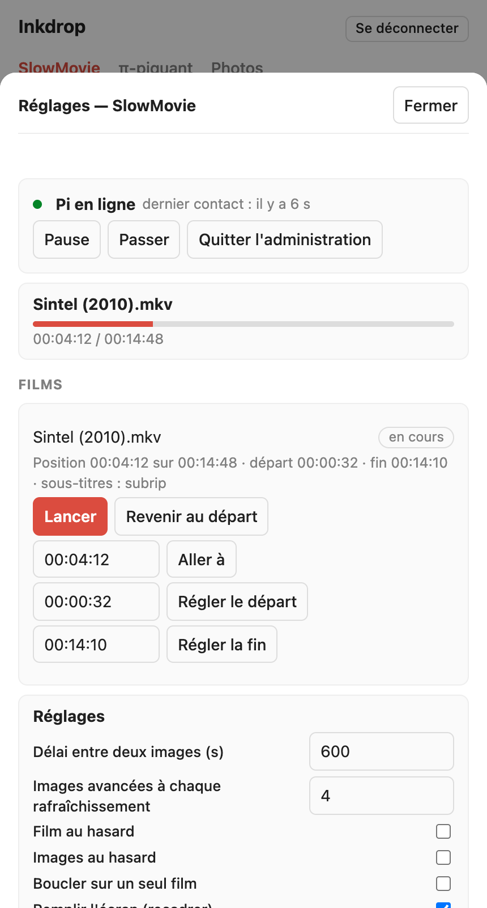
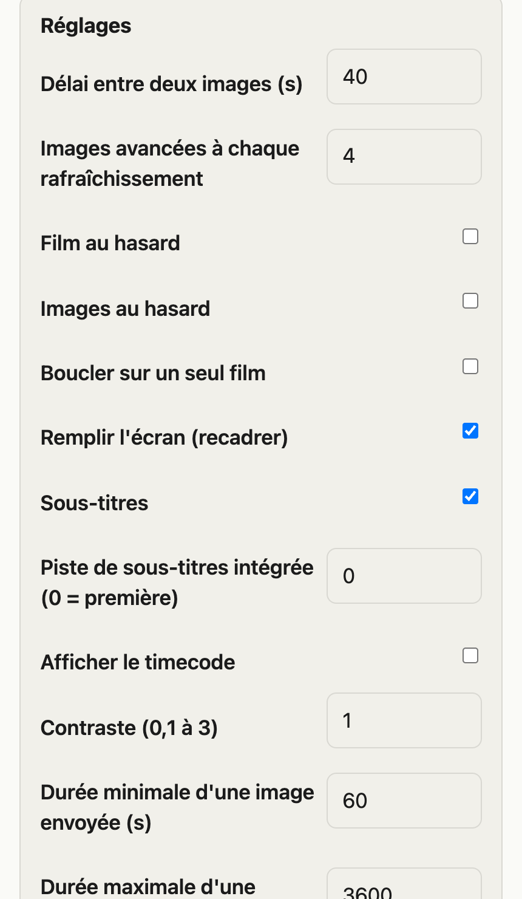
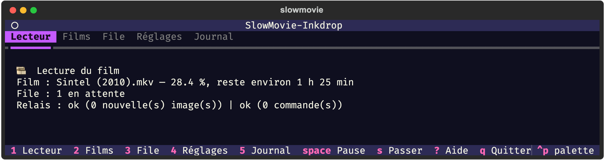
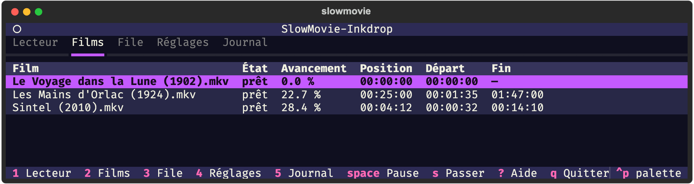
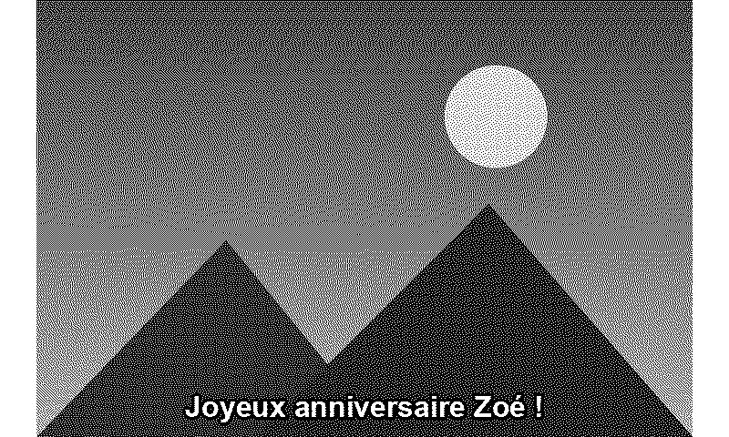

# slowmovie-inkdrop

> Ce projet a été vibecodé avec l'aide de l'intelligence artificielle.

Évolution de [SlowMovie](https://github.com/TomWhitwell/SlowMovie) (un film joué image par image sur un écran e-paper,
Raspberry Pi) avec trois apports :

1. **Envoi d'images à distance** : depuis un téléphone ou un ordinateur, on envoie une image et une durée. Elle remplace
   le film à l'écran pendant ce temps (le film est en pause), puis le film reprend là où il s'était arrêté. Les envois
   forment une file d'attente, protégée par un mot de passe partagé.
   Un **texte** de 128 caractères au plus peut accompagner l'image : il s'affiche en blanc cerclé de noir (corps de 20 px), centré en bas,
   avec une marge réglable sous le texte (`caption_margin`, 40 px par défaut) pour un écran en partie masqué par un cadre.
   Un onglet **π-piquant** tire au hasard un dessin d'après les décimales de π (1 à 200 décimales, angle de 1° à 359°),
   produit par le service [pi-piquant](https://github.com/charlescoiffier/pi-piquant), et l'affiche pour la durée choisie ;
   la légende (« π-piquant • 1 = 214° • 87 décimales ») est écrite par le Pi, et non dessinée par le service.
   Un onglet **Réglages** (mot de passe administrateur séparé) permet de piloter le Pi à distance : film, position de
   départ et de fin par film (pour sauter les génériques), sous-titres (y compris intégrés au film) et réglages.
2. **Interface terminal** (TUI Textual, au clavier, thème « galaxy » comme [cadav](https://github.com/charlescoiffier/cadav)).
3. **Ajout de films simplifié** : glisser-déposer dans un partage réseau, ou `slowmovie add film.mp4`.

## Aperçu

*Captures réalisées avec des données de démonstration (films libres de droits, aucun identifiant réel).*

### Sur la passerelle, depuis un téléphone

<table>
  <tr>
    <td align="center" width="25%"><br><sub>Envoyer une image, avec un texte et une durée</sub></td>
    <td align="center" width="25%"><br><sub>Page de confirmation : position dans la file</sub></td>
    <td align="center" width="25%"><br><sub>Onglet Réglages : état du Pi, films, départ et fin</sub></td>
    <td align="center" width="25%"><br><sub>Les mêmes réglages que la TUI</sub></td>
  </tr>
</table>

### Dans le terminal (TUI)

<table>
  <tr>
    <td></td>
    <td></td>
  </tr>
</table>

### Sur l'écran e-paper

Une image envoyée avec son texte, centré en bas (rendu tramé en 1 bit, comme l'écran) :



## Architecture

```
téléphone ──HTTPS──▶ relais (VPS, Docker) ◀──HTTPS sortant── lecteur (Pi) ──▶ écran e-paper
                       page d'envoi, file                      FILM ↔ IMAGE        ▲
                                                                  ▲                │
                                          TUI / CLI ──socket──────┘          seul à toucher l'écran
```

Le Pi n'ouvre aucun port : c'est lui qui interroge le relais.

## Installation

Voir [docs/deploiement.md](docs/deploiement.md) (relais, Pi, Mac, sécurité, recette sur le matériel).

Développement :

```bash
python3 -m venv .venv && .venv/bin/pip install -e '.[video,tui,relay,dev]'
.venv/bin/pytest -q && .venv/bin/ruff check .
```

Les tests utilisent un écran factice (`SLOWMOVIE_FAKE_DISPLAY=<dossier>` pour lancer le service sans matériel).

## Divers

- `legacy/` : les trois scripts d'origine (`slowmovie.py`, `slowmovie_config.py`, `slowmovie_plus.py`), pour référence.
- Spécification et plan : `docs/superpowers/`.
- **Licence** : le code repris de SlowMovie (Tom Whitwell, licence MIT) est signalé dans [NOTICE.md](NOTICE.md), avec sa
  mention de licence. La licence propre à ce dépôt n'est pas encore choisie.
