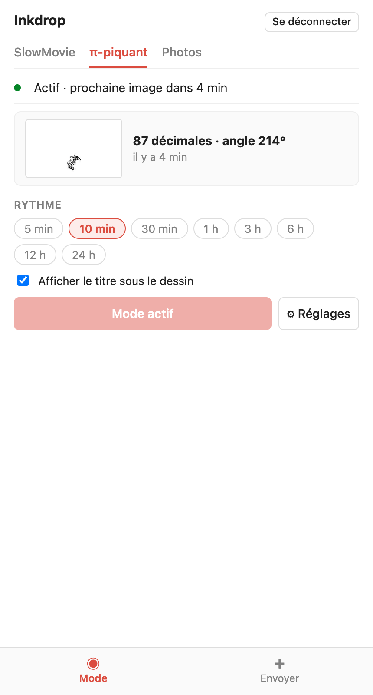
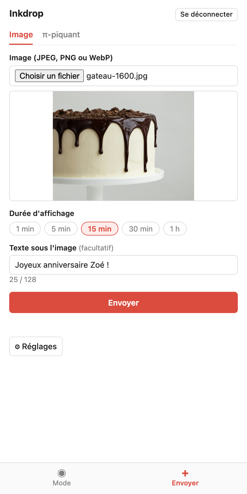
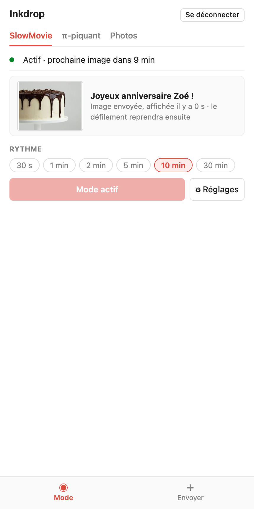
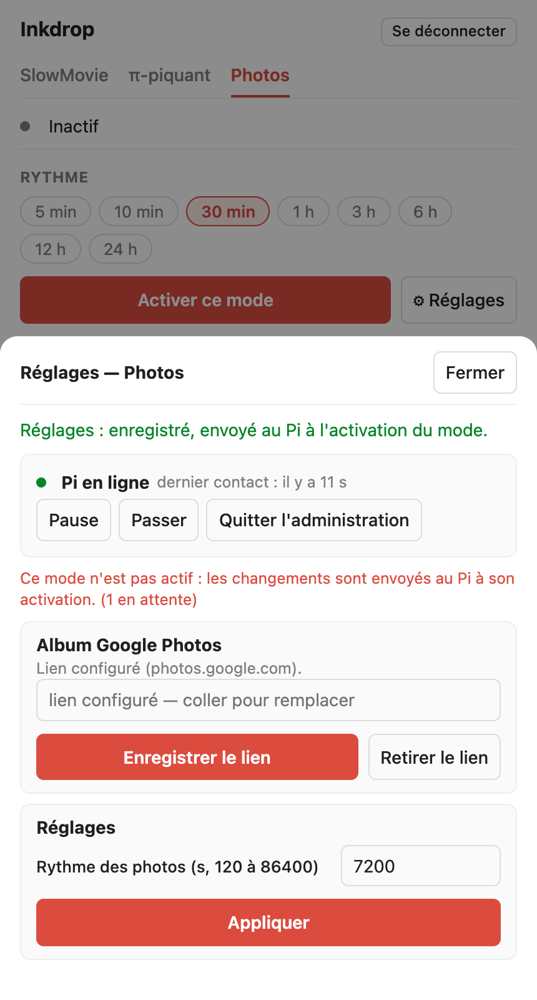
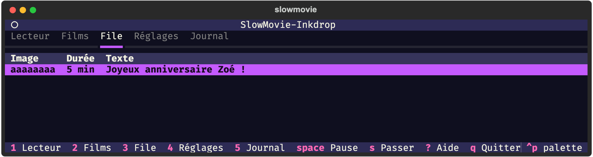
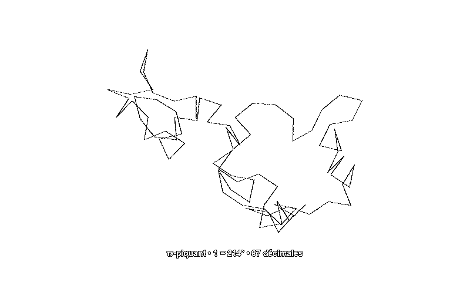

# slowmovie-inkdrop

> Ce projet a été vibecodé avec l'aide de l'intelligence artificielle.

Évolution de [SlowMovie](https://github.com/TomWhitwell/SlowMovie) (un film joué image par image sur un écran e-paper,
Raspberry Pi) avec quatre apports :

1. **Trois modes de défilement**, un seul actif à la fois, choisis depuis la passerelle :
   - **SlowMovie** : le film, image après image, comme l'amont ;
   - **π-piquants** : un dessin tiré au hasard d'après les décimales de π (1 à 200 décimales, angle de 1° à 359°),
     produit par le service [pi-piquant](https://github.com/charlescoiffier/pi-piquant), renouvelé à intervalle régulier ;
   - **Photos** : une photo tirée au hasard dans un album Google Photos (lien de partage, méthode non officielle),
     renouvelée à intervalle régulier.

   Le mot de passe général se saisit une seule fois, sur un écran de connexion (avec un bouton pour l'afficher et la case
   « Se souvenir de moi »). Il suffit ensuite pour changer de mode, de rythme (pastilles : 30 s à 30 min pour le film,
   5 min à 24 h pour les diaporamas) et pour afficher ou non le titre des π-piquants. Chaque mode actif montre une carte
   « en cours » : le film et son avancement, ou la miniature du π-piquant (décimales, angle) ou de la photo (rang dans l'album).
   Le bouton ⚙ de chaque mode ouvre ses réglages complets dans une fenêtre (mot de passe administrateur séparé) : pour
   SlowMovie, le film, la position de départ et de fin par film (pour sauter les génériques), les sous-titres (y compris
   intégrés) et les réglages du lecteur ; pour les π-piquants, le rythme libre et le titre ; pour les photos, le lien de
   l'album (un secret : jamais affiché ni journalisé) et le rythme. **Les réglages d'un mode inactif se modifient mais ne
   sont transmis au Pi qu'à l'activation du mode** (une seule commande). Les réglages communs (interrogation du relais,
   file d'attente, texte, contraste, plage horaire) sont dans le ⚙ de l'onglet Envoyer.
2. **Envoi d'images à distance**, dans tous les modes : depuis un téléphone ou un ordinateur, on envoie une image et une
   durée (ou on tire un π-piquant au hasard). Elle remplace le défilement à l'écran pendant ce temps, qui reprend ensuite.
   Les envois forment une file d'attente, protégée par un mot de passe partagé. Un **texte** de 128 caractères au plus peut
   accompagner l'image : il s'affiche en blanc cerclé de noir (corps de 20 px, 14 px pour la légende d'un π-piquant),
   centré en bas, avec une marge réglable sous le texte (`caption_margin`, 40 px par défaut) pour un écran en partie
   masqué par un cadre.
3. **Interface terminal** (TUI Textual, au clavier, thème « galaxy » comme [cadav](https://github.com/charlescoiffier/cadav)) :
   lecteur, films (position, départ et fin), file d'images, réglages (dont le mode et les rythmes) et journal.
4. **Ajout de films simplifié** : glisser-déposer dans un partage réseau, ou `slowmovie add film.mp4`.

## Aperçu

*Captures réalisées avec des données de démonstration (films libres de droits, photo Unsplash, aucun identifiant réel).*

### Sur la passerelle, depuis un téléphone

<table>
  <tr>
    <td align="center" width="16%"><br><sub>Connexion unique, mot de passe affichable</sub></td>
    <td align="center" width="16%"><br><sub>Mode actif : miniature du π-piquant en cours, rythme</sub></td>
    <td align="center" width="16%"><br><sub>Envoyer une photo avec un texte et une durée</sub></td>
    <td align="center" width="16%"><br><sub>L'image envoyée est à l'écran : le défilement reprendra ensuite</sub></td>
    <td align="center" width="16%"><br><sub>⚙ SlowMovie : film en cours, départ et fin, réglages</sub></td>
    <td align="center" width="16%"><br><sub>⚙ d'un mode inactif : réglages envoyés à l'activation</sub></td>
  </tr>
</table>

### Dans le terminal (TUI)

<table>
  <tr>
    <td></td>
    <td></td>
  </tr>
  <tr>
    <td></td>
    <td></td>
  </tr>
</table>

### Sur l'écran e-paper

Une photo envoyée avec son texte, centré en bas, et un π-piquant avec sa légende (rendu tramé en 1 bit, comme l'écran).
La marge sous le texte tient compte d'un cadre qui masque le bas de l'écran. Photo de démonstration :
[American Heritage Chocolate](https://unsplash.com/photos/vdx5hPQhXFk) sur Unsplash.




## Architecture

```
téléphone ──HTTPS──▶ relais (VPS, Docker) ◀──HTTPS sortant── lecteur (Pi) ──▶ écran e-paper
                       page d'envoi, file                      FILM / DIAPORAMA ↔ IMAGE ▲
                                                                  ▲                │
                                          TUI / CLI ──socket──────┘          seul à toucher l'écran
```

Le Pi n'ouvre aucun port : c'est lui qui interroge le relais.

## Installation

Voir [docs/deploiement.md](docs/deploiement.md) (relais, Pi, Mac, sécurité, recette sur le matériel).

Développement :

```bash
python3 -m venv .venv && .venv/bin/pip install -e '.[video,tui,relay,dev]'
.venv/bin/pytest -q && .venv/bin/ruff check .
```

Les tests utilisent un écran factice (`SLOWMOVIE_FAKE_DISPLAY=<dossier>` pour lancer le service sans matériel).

## Divers

- `legacy/` : les trois scripts d'origine (`slowmovie.py`, `slowmovie_config.py`, `slowmovie_plus.py`), pour référence.
- Spécification et plan : `docs/superpowers/`.
- **Licence** : le code repris de SlowMovie (Tom Whitwell, licence MIT) est signalé dans [NOTICE.md](NOTICE.md), avec sa
  mention de licence. La licence propre à ce dépôt n'est pas encore choisie.
